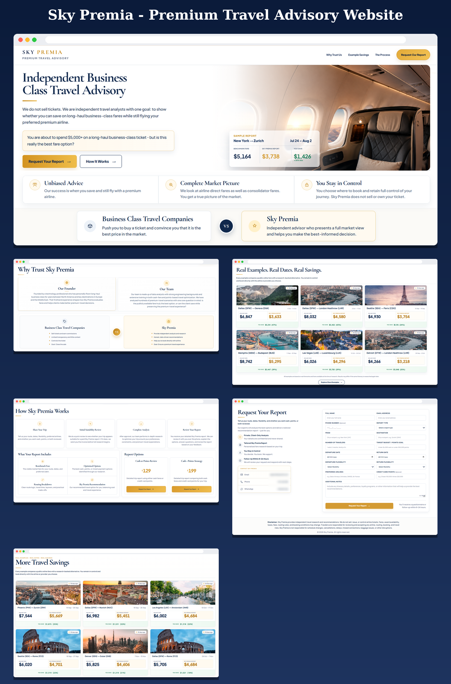
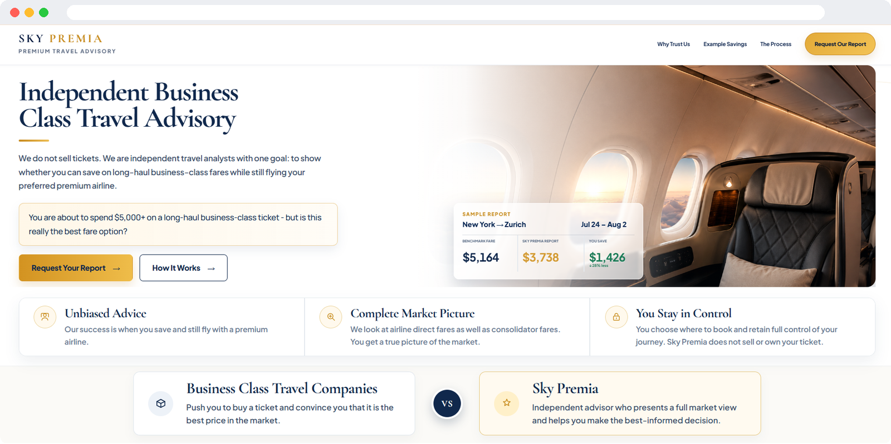
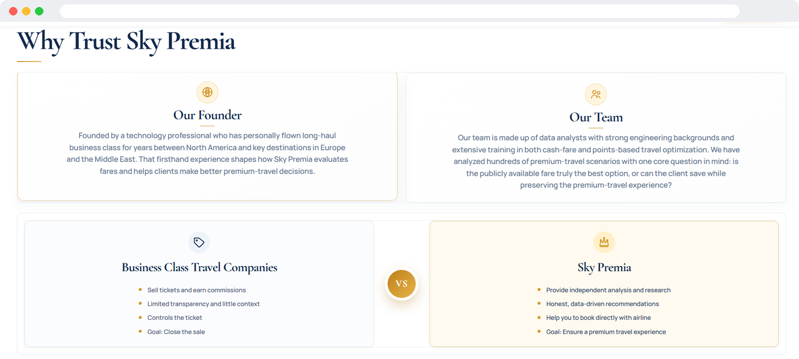
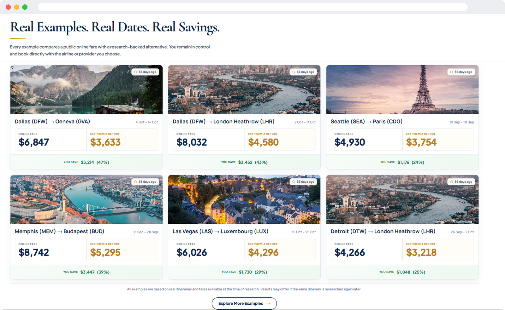
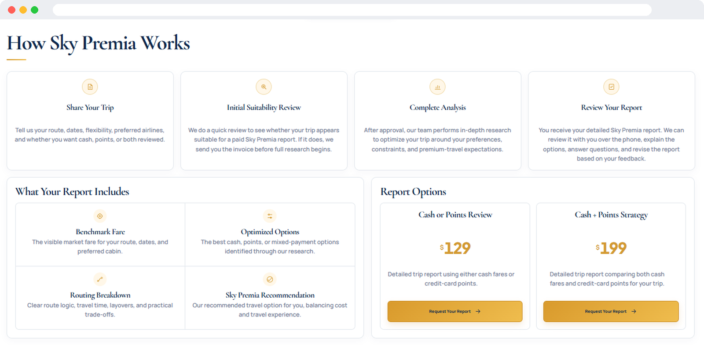
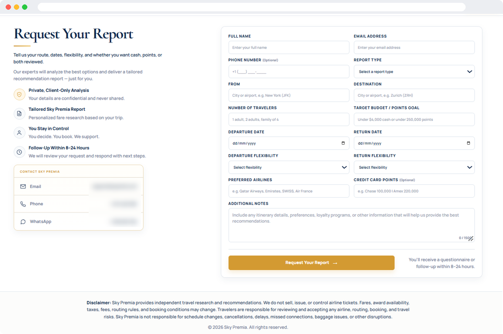
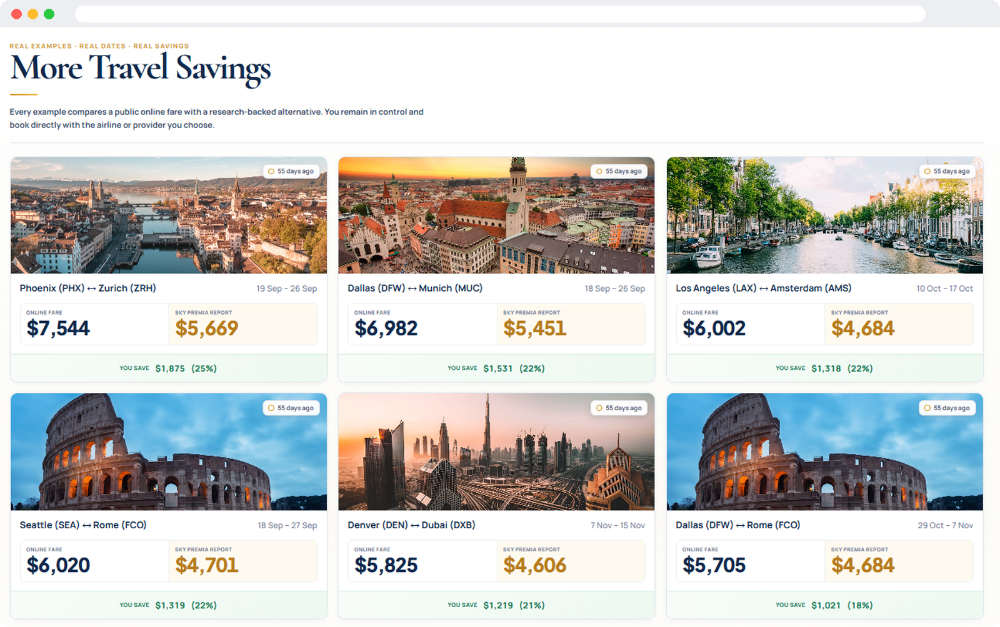

# Sky Premia: Premium Travel Advisory Website

**An independent business-class travel advisory website built on WordPress, designed to turn visitors into report requests.**

---

## Overview

Sky Premia is an independent premium-travel advisory company. It does not sell tickets. It researches long-haul business-class fares and shows clients whether they can save money while still flying their preferred airline.

This website presents the service, builds trust, and guides visitors to request a paid fare report.

## My Role

- Built and customized the website on **WordPress**
- Designed a clean, premium layout with a navy and gold brand look
- Implemented on-page **SEO** for the company website
- [Add anything else you did: forms, speed, hosting, etc.]

## Key Sections

| Section | Purpose |
|---|---|
| Hero | Clear value proposition and call to action |
| Why Trust Us | Founder, team and comparison with ticket-selling companies |
| Real Examples | Real routes and dates with benchmark fare vs. report fare |
| How It Works | Four-step process, report contents and pricing options |
| Request Your Report | Detailed lead form with 8-24 hour follow-up |
| More Savings | Extra case studies to build credibility |

## Screenshots

## SEO Work

- Optimized page titles and meta descriptions
- Structured headings (H1 to H3) around target keywords
- Optimized image sizes and alt text
- [Add what you really did: sitemap, Google Search Console, schema, speed, etc.]

## Tech Stack

- WordPress
- [Theme / page builder, e.g. Elementor]
- [SEO plugin, e.g. Yoast SEO / Rank Math]
- HTML, CSS

## Live Website

[https://your-website-link.com](https://your-website-link.com)

## Author

**Sundas**: [GitHub](https://github.com/sundas-stack)

> Note: This repository contains screenshots and documentation only. Content and brand belong to Sky Premia.
